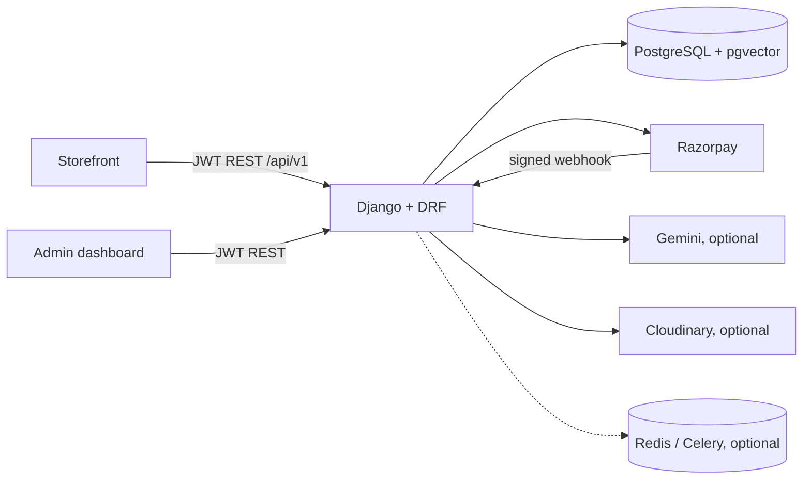
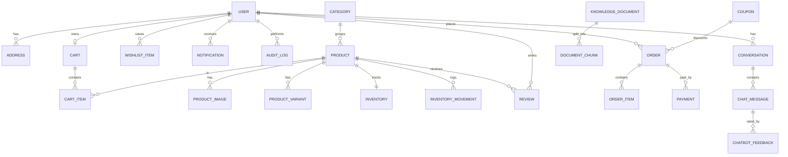

# Architecture

Modular monolith. React storefront + React admin (Vercel) -> Django REST API (Render) -> PostgreSQL + pgvector (Supabase). Optional: Redis (Upstash), Gemini API, Razorpay, Cloudinary.



## RAG pipeline
```mermaid
flowchart TD
  U[Admin uploads txt/md/pdf] --> V[validate type + size] --> X[extract + clean] --> C[chunk] --> E[embed, reusing unchanged chunks]
  E --> S[(chunks: JSON + vector(256) HNSW + GIN full-text)]
  Q[Customer question] --> R{intent router}
  R -->|order| T1[get_order_status: own orders only]
  R -->|product / age / budget| T2[search_products, recommend]
  R -->|compare| T3[compare_products]
  R -->|stock| T4[check_inventory]
  R -->|specs| T5[get_product_details]
  R -->|policy / other| H[hybrid retrieval: pgvector top-N + full-text top-N, rerank semantic+keyword]
  S --> H --> G[answer + citations; optional Gemini phrasing, timeout + fallback]
```
Prices, stock and order status are always read from the database. Retrieved text is treated as untrusted. If nothing relevant is found, the bot says so.

## ER diagram


## Key rules
- Paid only after server-side HMAC verification (checkout signature or webhook); `mark_paid` is idempotent; `payment.failed` never downgrades a paid payment.
- Checkout is one transaction with row locks on inventory in a fixed order (no overselling, no deadlocks); cancel restocks; unpaid orders expire via `expire_pending_orders`.
- Refunds go through the gateway and are audit-logged; no gateway keys means a 503, never a fake success.
- Soft-deleting products keeps order history intact.
